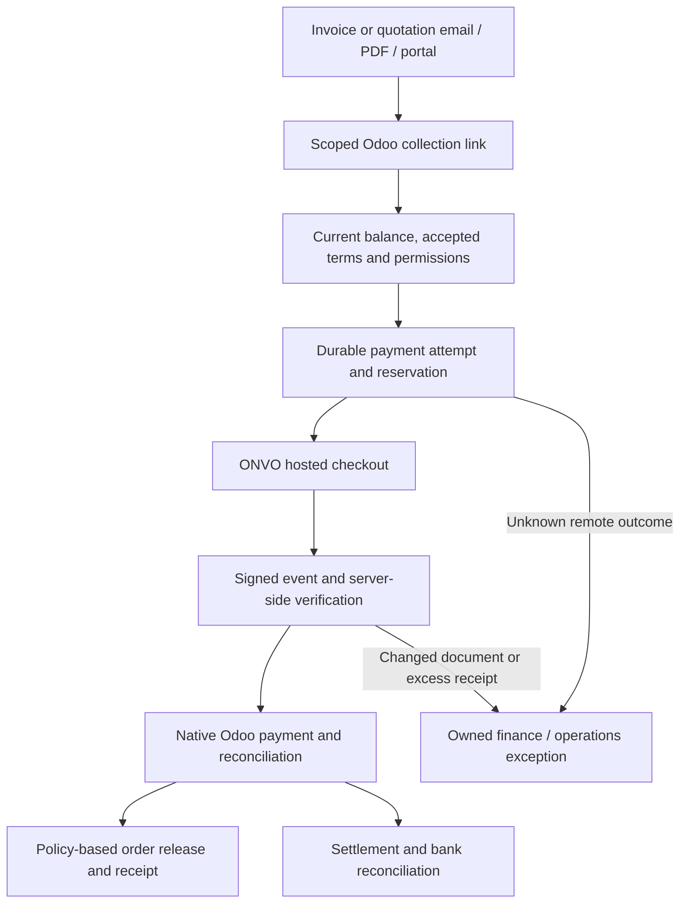

# ONVO for Odoo: comprehensive B2B payment model

Status: proposed product and architecture, not implemented by release 0.5.0. The agreed direction is configurable deposits and payment terms per merchant and customer. The scope includes outbound facturas/invoices and quotations, the customer portal, accounting, collection operations and eventual advanced billing.

Related documents: [term catalog and rule semantics](B2B_TERMS_CATALOG.md), [implementation and acceptance plan](B2B_IMPLEMENTATION_PLAN.md), [current Apple Pay setup](APPLE_PAY_SETUP.md).

## 1. Product definition

Every eligible outbound invoice and quote gets a clear payment action. The action opens a branded Odoo page showing the current obligation, its terms and the available ways to pay. Odoo determines the amount and who owes it; ONVO collects the authorized payment. Verified results return to Odoo's transaction, sales and accounting workflows.

The product supports simple merchants through presets and complex merchants through composable rules. It must support agreements such as “20% at acceptance, 30% on delivery, 40% Net 45 after acceptance of the work, 10% retained until warranty release,” without making the buyer interpret a spreadsheet.

“Comprehensive” means an extensible rules model with explicit support levels. A scheduled obligation does not imply that a customer's card can be automatically charged. Financing, escrow, mandates, recurring debits and marketplace payouts require distinct supported services and agreements.

## 2. Commercial policy hierarchy

Resolve policy in this order:

1. Merchant/company default and applicable legal-entity settings.
2. Customer agreement or approved customer-specific policy.
3. Contract/project policy, if present.
4. Authorized document-specific amendment.

Specificity alone must not override safeguards. Credit holds, unsupported currency, provider restrictions and approval requirements still apply. Sales staff can select approved presets; finance managers approve exceptional discounts, waived deposits, credit-limit changes and overdue arrangements. Store the resolved policy version and acceptance evidence with the document.

Offer merchant profiles for immediate collection, deposit plus balance, approved credit terms, scheduled installments and milestone billing. Each profile is editable through ordinary fields. An advanced builder exposes additional conditions progressively. Changes after acceptance produce a versioned amendment; old emailed links must not silently collect under materially changed terms.

## 3. Buttons, documents and customer journeys

| Context | Primary action | Behavior |
| --- | --- | --- |
| Quotation requiring acceptance and prepayment | Review quote and pay / Aceptar cotización y pagar | Show terms and any required acceptance/signature, then collect the amount needed for that stage. |
| Deposit request | Pay deposit / Pagar anticipo | Display deposit amount, total contract value and how the deposit will be credited. |
| Posted customer invoice | Pay invoice / Pagar factura | Read current residual and approved payment options when the customer opens the page. |
| Installment or milestone due | Pay amount due / Pagar cuota | Show this obligation, its due date, prior allocations and remaining schedule. |
| Approved credit customer | View invoice and terms | Preserve Net terms; permit voluntary early payment when policy allows. |
| Fully paid, voided or superseded document | View status | Explain the state; prevent another payable checkout. |
| Customer statement | Review balances | Show eligible documents; consolidated payment is a later capability. |

Place the action in outbound email, portal pages and printable PDF/QR variants. Use an Odoo-controlled document/collection link, not an ONVO session URL embedded permanently in an email or QR. Validate access, revision, amount and currency again before creating a session. Expiring processor sessions can then be replaced safely without reissuing every document.

Support customer language, merchant branding, invoice number, purchase-order reference, billing entity and contact information. Never show a payment CTA on vendor bills, credit notes, drafts not approved for collection, or unsupported-currency documents.

The approving buyer and paying contact can differ. A purchasing manager may accept a quote and forward a limited payment invitation to accounts payable. Record the payer separately without reassigning the invoice's debtor. Offer portal-login requirements for sensitive customers and explicit delegated payment links; possession of a payment link must not grant access to unrelated company documents.

## 4. Quote, deposit and invoice semantics

A quotation is a commercial proposal, not a posted invoice. Quote acceptance, order confirmation, payment success, fulfillment and invoice settlement remain separate events with explicit rules connecting them.

Use Odoo's native online-confirmation and prepayment mechanisms where suitable. Confirm an order only when its required acceptance and payment threshold are satisfied, or when an approved credit policy permits confirmation without prepayment. A browser return or an unverified webhook never satisfies that threshold.

Quote deposits must flow through an approved down-payment/customer-advance process. Final invoicing deducts or reconciles the advance exactly once. Do not count the same money once against a quote and again as a new invoice payment. The timing of fiscal documents, taxes and customer advances is determined by the merchant's Odoo localization and finance configuration, reviewed before deployment.

Invoice schedules and multiple invoices are different concepts. One invoice can have several maturity lines; one contract can instead generate several milestone or down-payment invoices. The UI must say which model applies. Support both without creating a second receivables ledger.

## 5. Amount calculation and allocation

For every payment attempt, calculate the collectible amount on the server from the current document state, accepted policy, existing allocations, credits and active collection reservations. Never trust an amount, discount, due date or currency submitted by the browser.

Allow policy-controlled choices: entire balance, currently due installments, specified deposit/milestone, voluntary early payment, or customer-entered partial amount within approved limits. Bound every selection to an explicit obligation and available residual. Disallow zero/negative amounts and overpayment by default. Intentional customer pre-funding is a separate credit-balance product with clear accounting treatment.

Allocate explicitly. A single-invoice payment goes to that invoice's permitted maturity lines. Within an approved schedule, use oldest due first unless the contract specifies another order. Let the buyer review allocation before payment. A later consolidated payment must have one debtor, merchant/company, currency and provider context; cross-company or cross-currency netting requires a separate finance process.

Round using the invoice currency and reconcile the final rounding difference on the last installment. Do not silently convert an unsupported invoice into USD/CRC. Discounts, tax effects, withholding, deductions and disputed amounts must be represented by the proper Odoo accounting adjustments, not by pretending the processor collected more money than it did.

## 6. State and accounting model

| Layer | Important states | Authority |
| --- | --- | --- |
| Commercial document | draft, sent, accepted, confirmed, cancelled, superseded | Odoo Sales and approved amendments |
| Obligation | not triggered, scheduled, due, partly satisfied, satisfied, waived, disputed | Resolved term rules plus accounting allocations |
| Payment attempt | created, creating remotely, pending, unknown outcome, succeeded, failed, expired, cancelled | Odoo attempt record plus verified ONVO state |
| Accounting payment | draft/posted, allocated/unallocated, partially/fully reconciled | Odoo Accounting |
| Settlement | awaiting payout, settled, fee-adjusted, exception | Settlement evidence and bank reconciliation |

Keep these layers related without collapsing them into a single “paid” boolean. A successful processor transaction is not proof that a bank payout has arrived. Odoo's native post-processing should create/link payment records and reconcile eligible invoices; do not directly write an invoice's payment-state field.

Proposed finance setup uses a configured ONVO payment journal and appropriate outstanding/clearing accounts. Record gross collections against receivables, processor fees separately, and reconcile net payouts against the clearing balance and bank statement. The merchant's accountant approves the exact journal/account mappings and localization treatment. Settlement automation is conditional on verified ONVO export/API capabilities; controlled imports and manual reconciliation are valid first versions.

## 7. Duplicate prevention and changed balances

Use a durable collection attempt with a document revision, obligation identifiers, exact amount/currency, company, provider, environment, expiration and provider references. Lock the collection decision while reserving the amount. Reuse one eligible pending session for that obligation rather than opening parallel payable sessions from repeated email clicks.

Revalidate before session creation and when processing success. When a document is revised, cancelled, paid elsewhere or credited, revoke the local collection request and attempt to expire the corresponding remote session. Never assume remote expiry succeeded without confirmation.

An old session can still settle during a race with a bank payment, document cancellation or another checkout. Record the actual money received, stop automatic fulfillment if the contract no longer matches, and route excess/unmatched money to a finance exception queue for allocation, customer credit or approved refund. Do not discard a real payment merely because its original invoice changed.

ONVO's reviewed Checkout creation schema does not document an idempotency key. The current connector therefore cannot promise exactly-once remote session creation after an ambiguous timeout or database rollback. B2B hardening must persist attempt intent before the external call, distinguish a definite rejection from an unknown outcome, and prevent blind retries. Resolve unknown outcomes through a supported provider lookup or an operator before issuing another payable session.

## 8. Credits, refunds, disputes and collection exceptions

Credit notes reduce receivables through Odoo's accounting process. A refund is a separate movement of funds: link it to the original payment, enforce refundable limits, record approval and reconcile the accounting adjustment. Partial refunds must preserve the remaining paid allocation. Never mark a refund complete just because an API request was accepted.

The current connector does not implement refunds from Odoo, recurring charges or saved-card collection. The first B2B release should expose accurate status/instructions for manual ONVO operations and accounting follow-up; provider-driven automation belongs in an explicitly tested later capability.

Track disputes, short payments, withholding claims, missing remittance advice, incorrect references, excess payments and chargebacks as distinct exception reasons. Allow undisputed portions to remain collectible if policy permits. Suspending reminders must not erase a debt or silently waive an obligation. A chargeback does not justify deleting the original posted payment history.

## 9. Collections, credit control and operations

Provide an accounts-receivable workspace with due/overdue amounts, current collection attempts, promised payment dates, broken promises, customer disputes, credit holds, failed webhooks, reconciliation exceptions and missing settlement evidence.

Reminder sequences are merchant-configurable by customer segment, language, due date and grace period. Suppress or adjust reminders for pending payments, approved payment plans and disputes. Reuse Odoo's mailing/chatter mechanisms and deduplicate notifications; no messages are sent as part of this planning task.

Credit control includes approved limits, unused credit, exposure from open invoices and committed orders, grace periods, overdue thresholds, and configurable holds on order confirmation, shipment or new credit. Distinguish an informational warning from a blocking rule. Require approval and a reason to override a hold.

Maintain an audit trail for policy changes, approvals, payment attempts, allocation changes, provider events, refunds and releases of holds. Restrict credentials and finance operations by role/company. Store minimal provider evidence and redact secrets and unnecessary customer/payment data from logs. Reporting is merchant-local by default; this does not add a central analytics collector to the free connector.

## 10. Scope and readiness

The current payment connector supplies hosted checkout, signed Checkout webhooks, server-side result checks, pending-session reconciliation, branding and the Apple Pay setup/test helper. These capabilities do not establish that all quote/invoice accounting flows have been validated.

The comprehensive B2B product is delivered in layers: native quote/invoice integration and accounting proof first; configurable collection policies and deposits next; advanced schedules and exception operations after that; recurring collection, settlement automation, refunds and embedded wallets only behind verified capability gates.

A merchant is launch-ready only when its specific company/currency/journal setup, quote policy, invoice workflow, refunds/exception procedure and supported payment methods pass acceptance testing. The term catalog describes the target design, not a claim that every feature is available today.

## Primary evidence for the design

- [Odoo 17 quote prepayment and payment-link logic](https://github.com/odoo/odoo/blob/17.0/addons/sale/models/sale_order.py)
- [Odoo 20 Sales transaction post-processing](https://github.com/odoo/odoo/blob/20.0/addons/sale/models/payment_transaction.py)
- [Odoo 20 invoice payments and reconciliation](https://github.com/odoo/odoo/blob/20.0/addons/account_payment/models/payment_transaction.py)
- [Odoo 20 invoice payment links and installments](https://github.com/odoo/odoo/blob/20.0/addons/account_payment/models/account_move.py)
- [Odoo payment terms and installment documentation](https://github.com/odoo/documentation/blob/19.0/content/applications/finance/accounting/customer_invoices/payment_terms.rst)
- [Odoo down-payment documentation](https://github.com/odoo/documentation/blob/19.0/content/applications/sales/sales/invoicing/down_payment.rst)
- [ONVO Checkout API](https://docs.onvopay.com/en/api/crear-una-sesion-de-checkout) and [signed webhooks](https://docs.onvopay.com/en/webhooks)
